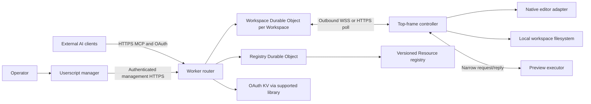

# Architecture v0.1

## 1. Boundaries

One deployment, SQLite-backed Durable Object classes Registry and Workspace. One Registry per installation: grants/assignment authority, global generator reservations, Resources and management configuration. One Workspace instance per stable ID: connection lease, epoch, bounded queue, operation journal. OAuth provider library uses its own KV binding; Registry is strongly consistent authorization overlay, never KV alone for revocation. No D1/R2/queues initially. Registry is small and transactionally serializes policy; per-Workspace execution never holds global lock across provider calls. Gateway has no Perchance credentials. Browser-local scratch/checkpoints owned by userscript storage, not shared page localStorage. Source authority is native editor/draft; server saved source independently read. Versioned Resource authority is Registry; local drafts are caches. No central browser tab.

Use TypeScript strict, discriminated messages, generated JSON Schema from one shared contracts package, standards-compliant SDK with pinned versions. Bundle userscript via esbuild or equivalent into single .user.js plus .txt distribution. Target Firefox + Violentmonkey first; verify actual supported version/manager and GM sandbox. Other managers not presumed. Use explicit native adapters by detected contract, no global CSP disable, no broad page bridge. CodeMirror and srcState are provider internals, capability probe on each document. Do not monkey-patch native Helper or access its backend. UI uses DOM textContent/safe sanitized Markdown, styles scoped to manager, no external CDN. Separate unprivileged preview frame role from top-frame privileged role; only matching Perchance origin/expected frame. Treat generator code as hostile.

## 2. Identity and ownership
Registry data: Installation(id,schemaVersion,policyRevision); Agent(id,label,state); Workspace(id,label,bindingRevision,agentId,state,permissionsRevision); Binding(workspaceId,generatorId,slug,publicId,draftId,browserInstallationId); Grant(id,agentId,workspaceId,bindingRevision,clientId,scope,state,expiresAt); GeneratorReservation(generatorId,workspaceId,epoch,state); Resource(id,kind,revision,hash,metadata,body); Assignment(scopeType,scopeId,resourceId,revision policy); AdminCredential(hash,expiry,revoked); PendingApproval(id,requestDigest,workspaceId,expiresAt,state). Random 128-bit IDs, secrets >=256-bit, cryptographic RNG. Draft ID may be empty; generator ID is canonical provider value serialized losslessly. New unsaved fork uses provisional identity, cannot inherit template ownership. Explicit reconcile on creation transitions to verified ID.

Tab Instance ID random per document; do not rely on cloned sessionStorage (duplicated tabs can copy it). Browser installation identity persistent in GM storage. Each document requests lease with binding tuple and challenge, proves possession of installation credential; Registry verifies explicitly attached Workspace. On reload reconnect only if matching identity and previous lease expired/released; two live documents claiming same binding fail closed; operator takeover increments epoch and holds uncertain writes. No automatic rebind from slug. Slug changes require independent ID check; navigate to unrelated generator -> detach. Draft switch -> hold and require explicit binding update. Reservation covers all Workspace writers to same Generator ID, even distinct drafts. Read-only Workspace may coexist. Unknown write keeps reservation until reconciled. Does not control other browsers/native users; native staleness check mandatory.

| Workspace state | Trigger | Transition |
|---|---|---|
| UNBOUND | explicit attach + valid identity | ATTACHED_OFFLINE |
| ATTACHED_OFFLINE | valid lease claim | READY, new Epoch |
| READY | accepted operation | BUSY |
| BUSY | verified terminal | READY |
| READY/BUSY | lease expired, reload, suspend | OFFLINE/PAUSED; dispatched unknown -> HOLD |
| any | wrong generator/draft, native conflict, unknown effect | HOLD |
| HOLD | read-only reconciliation + operator decision if ambiguous | READY or OFFLINE |
| any | detach | UNBOUND; invalidate binding revision and grants |

Heartbeat WSS target 60s, lease 180s provisional; browser timers can throttle, expire without taking unsafe ownership. Socket hibernation attachments contain only identity and epoch, not source. Authenticate WebSocket using single-use short TTL ticket via GM-authenticated HTTPS; do not put long-lived secrets in URL. Prefer first-frame proof with 5s auth deadline, challenge ticket never exposed to page. If CSP/manager cannot open WSS safely, use authenticated GM HTTPS long poll (25s max, jitter/backoff) with identical envelope, no CSP weakening. Budget for 10 idle pollers: ~34,560 requests/day at 25s if 24h; measure full usage. Socket handshake and page bridge verified in P01/P02. Authenticated origin policy, explicit CORS if needed, reject unexpected origins for MCP, no wildcard credentials. Browser WebSocket cannot set arbitrary headers. No credentials passed via page messages.

## 3. Gateway API and OAuth
Canonical HTTPS issuer configured after deploy, exact normalized origin. Routes: GET /health (version/setup state only); OAuth library routes /authorize, /token, /register (compatibility), /revoke and standards discovery; /mcp/{agentId} exact protected resource URL; /api/v1/admin/* authenticated management; /api/v1/tab/* separate browser execution API; /api/v1/approval/* admin-only; /api/v1/artifacts/* scoped access. No agent route accepts workspace override. Resource-specific protected-resource metadata and audience verification; use current MCP 2026-07-28 and legacy 2025-11-25/2025-06-18 via SDK supported profiles, negotiate/validate headers, session IDs only if older transport requires, never use as security identity. Verify exact endpoint mapping even for legacy clients omitting resource indicator; explicit approved Agent selection from pending request; unsupported client fails closed. No dynamic registration automatically confers a Grant. Prefer CIMD and support DCR where client requires; exact redirect URI validation, HTTPS except permitted loopback, PKCE S256, state, issuer binding, one-use codes, refresh rotation where library supports, no token passthrough. Verify metadata URL fetching safety using SDK and restricted network policy. Do not hand-roll cryptographic OAuth. Validate library compatibility with per-Agent resource audience and storage in P02; pin tested version. If exact path resource model unsupported choose per-Agent resource handler adapter, not origin-only trust.

Bootstrap: operator supplies high-entropy BOOTSTRAP_SECRET as Cloudflare secret at deployment; setup wizard pairs over HTTPS once; Registry transaction marks consumed, returns management credential once, store only digest server-side, GM sandbox client storage. Separate tab execution credentials per installation, narrow scopes, rotation and revocation. Admin auth never granted via MCP. Recovery requires dashboard secret rotation plus explicit recovery command that invalidates old credentials, grants and active leases; do not auto-reset when secret changes. Operator approval: gateway records verified OAuth authorize request (clientId, validated redirect, resource, requested scopes, PKCE, expires), displays human-readable pending code in OAuth page; operator manager lists matching request and approves exact digest or denies, page polls status with one-use opaque handle. No sensitive values in page URLs except protocol-required short-lived codes/state. Worker completes OAuth only after approval and verifies same request; CSRF protection, no auto-approval, no credentials in HTML. Pending TTL 5 min, code TTL 60s, access token target 15 min, refresh target 30 days (verify library options). Registry checks active grant + current binding and permission revision every admission, including refresh policy; revoke rejects future calls immediately at Registry even if KV cache stale. Already-dispatched provider effect cannot be revoked retroactively.

## 4. Browser RPC
Envelope v1: {version,operationId,workspaceId,epoch,bindingRevision,tabInstanceId,deadlineMs,tool,args,expectedRevision?,traceId}. Replies {version,operationId,epoch,tabInstanceId,status,result?,error?,revision?,effectState}. Strict sizes, schema, immutable IDs; no dynamic method dispatch. Validate both ways. Gateway authenticates lease and grants before enqueue and immediately before dispatch; top controller revalidates current document, native identity, revision and permission decision before mutation. Operation ID ledger keyed by Workspace, reject same ID with different digest. Dedup known transport retries; do not claim exactly-once external side effects. Separate MCP request ID from Operation ID; identical new tool call not automatically same intent. Mutating retry requires explicit operation handle and reconciliation. Local journal durable before dispatch. Send ACK before effects; terminal response stored before return. Idempotent checkpoint and scratch writes use staging and atomic commit where possible. Native edits use snapshot + compare/readback, compensate only if revision unchanged; else HOLD and preserve both versions. No blind rollback of operator edits.

| Phase | Meaning |
|---|---|
| ADMITTED | valid grant, queue capacity; no effect |
| DISPATCHED | may reach browser |
| RUNNING | browser accepted and recorded intent |
| SUCCEEDED | outcome verified at required tier |
| REJECTED | known no effect |
| PARTIAL | known subset committed; enumerate effects |
| UNKNOWN | effect possible but not verified; hold writes |
| CANCELLED | confirmed no mutation, not merely transport abort |

Serialize mutation and eval/preview lifecycle per Workspace; simplest initial queue serializes all browser tools. Independent Resource reads may bypass queue. Queue max 8, one executing, deadline starts at admission; return QUEUE_FULL without effects. Default interactive deadline 30s, explicit long jobs up to 1h subject to tool bounds and measured client deadline. For clients timing out earlier, long operations return operation handle; operation_status retrieves results; cancel_operation signals cooperative stop. Do not require MCP Tasks support. No automatic repeat after disconnect; query operation ledger; safe read retries max 2 with jitter. Lease invalidation stops new work, never asserts cancellation. Journal summaries retain 7 days/1000 per Workspace, bounded; unresolved intent cannot be evicted until reconciled. Transient tool result retention 10 min, max 8MiB per Workspace initial; larger via chunked artifact path. Never store secrets/full source in routine logs.

## 5. Local execution and persistence
Top adapter waits app.data.generator, editors, srcState.ready, native edit mode/draft settled; detects read-only/helper busy/collaboration. PJS/HTML getters/setters native, recompute dirty status, no markClean. Native draft ID and workspace ID verified on each call. Revision derived from monotonic change counter and canonical digest (both panels and exact src manifest/bytes as required); detect manual edits via native callbacks or before/after reads. Setters may not expose atomic multi-file commit; preflight all writes, checkpoint, apply sequentially, verify each, report partial if compensation unsafe. srcState paths relative, byte-preserving, await idle and pending viewer buffers; do not clear pending edits. Scratch private per Workspace; GM storage with bounded chunked records and generation manifest pointer (atomic single manifest update, orphan cleanup); test quotas, do not assume 2GB. Alternative isolated IndexedDB/OPFS only if proven inaccessible to generator origin; browser page storage is not credential-safe. If binary quota insufficient, explicit export or approved artifact storage extension, no hidden cloud upload. imports read-only revision-pinned cache. Filesystem canonical paths main.pjs/index.html/src/.../scratch/.../imports/...; reject abs, dot segments, traversal, Unicode alias, invalid native segments, ambiguous casing; normalize only documented separators, no silent collisions. Text UTF-8 strict; binary via typed paths; exact bytes including zero-byte anomaly. Local Checkpoints capture panels+src paths and bytes with digest, save base, identity; retention defaults last 5 + pinned, quota 64 MiB provisional; refuse mutation when required checkpoint cannot fit, offer export/eviction.

Preview uses native reload/update path; use actual iframe window source+exact origin and document/preview epoch; untrusted page messages can lie, so results are generator-controlled data, never authorize actions. Preview role does not load privileged controller credentials or expose GM APIs. Prefer native bridge where safe; own narrow adapter only for allowlisted preview eval/diagnostics, no generic privileged RPC. Native preview JS arbitrary within that origin and may affect external services; explicit capability. Never execute agent JS in top editor or privileged userscript. page_refresh readiness verifies expected source revision applied, not merely iframe load; capture generation-scoped errors, logs, lint settle and freshness. Preamble support requires validated native hook or injection before generator startup; no claim until tested. Frozen synchronous page may need human reload; JS timers cannot interrupt a blocked main thread. set_viewport_size controls iframe logical dimensions with bounded visible scale, restores on detach. Screenshot real-pixel capability test; DOM snapshot/canvas reconstruction is not automatically equivalent. Browser user-consented capture or authorized alternate rendering if required; no permission escalation by stealth.

execute_js: terminate-able sandbox Worker or vetted isolated JS engine, no DOM, credentials, ambient fetch, imports or arbitrary page execution; message broker permits only workspace file operations with same ACL/limits. Native Web Worker alone has fetch and cannot be treated as a security sandbox; test network isolation, CSP and CPU/memory limits. Prefer isolated engine if worker cannot enforce boundary. Restrict max execution and output; terminate on timeout; report staged effects, no arbitrary eval in privileged worker. Cloudflare only relays, not executes arbitrary agent code. Public fetch_url: dedicated controlled browser/gateway adapter, HTTPS public destinations, explicit approved POST scope, no cookies/authorization forwarding, reject local/private/link-local/metadata hosts, DNS rebinding and every redirect, byte/time limits; if browser cannot prove destination policy, use restricted gateway allowlist or operator-approved fetch; document coverage. Not an open proxy.

## 6. Save and external effects
Before Save: verify generator ID, slug, owner or explicitly authorized edit context, draft, native save state, provider base revision; reserve writer; capture complete intended snapshot and previous saved snapshot, settle src pending buffers, native app.saveGenerator or control. Never construct raw /api/save or call markClean. Preserve native staleness and challenge checks. Confirm native receipt plus independent /api/getGeneratorPageData and exact panel strings/path set/file lengths+SHA256 from uploads CDN. Source and derived-data effects distinct. status created on update => HOLD. stale => HOLD; no automatic override. clean no-request => ALREADY_MATCHES only after comparison. Challenge => operator action. Timeout/lost reply => UNKNOWN; reconcile after provider settles, single early previous-source match insufficient. Mixed/different/wrong ID => HOLD. Do not auto-repeat upload, create, rename, listing, restore or delete after unknown. Create inert fork, check ID/owner, Unlisted explicitly then stage. Save on user's explicit instruction and configured permission; publication separate. Production server-state restore requires backup, exact digest, fresh approval, reconcile-only call after timeout; alternative authorized backend needed if native service inaccessible. Never extract native AI credentials or replay private Helper sessions.

## 7. Resources
Registry SQLite immutable revisions and active pointer; transactions compare expectedRevision; drafts local; publish is atomic pointer swap. Resource fields id,kind,title,description,version/revision,hash,body/files,source/provenance,license,dependencies,enabled. Package format manifest.json + skills/<id>/SKILL.md + refs, workflows/<id>.md, instructions/<id>.md, documentation/<id>...; seed the repository's eleven default skills; accept optional flat skill ZIP via import mapping, report excluded, opencode optional reference not active. Validate archive paths, duplicates, symlinks, compression ratio, uncompressed limit, count, UTF-8, metadata, dependency cycles; preview all conflicts. Initial 16 MiB uncompressed/500 files, 1 MiB per text resource, adjustable after measurement. Separate source upstream revision from customized fork; no silent overwrites. Resolve effective set global -> Workspace -> Agent, more specific same ID replaces; deterministic sort ID; missing dependency explicit error; security policies independent. Snapshot library revision at task handle when client uses it; otherwise include revision in each retrieval, no false guarantee of task pin. Tools list_skills/skill/list_workflows/get_workflow/get_instructions/search_documentation/read_documentation support all web clients; optional resources/prompts mirror same ACL, never require them. Do not execute resource text. Backup excludes credentials, restores inert definitions; grants require reauthorization. Private library stored cloud; operator can export and delete history explicitly.

## 8. Operations and evolution
Use structured redacted events {traceId,operationId,workspaceId,epoch,tool,phase,errorCode,durationMs,bytes,revision}; sanitize provider text and URL secrets; no prompt/source/token logs, no raw exceptions in user exports. Health distinguishes gateway, auth, lease, adapter, preview and provider. Quota accounting counts calls, CPU, storage, transfers; per-Workspace limits prevent starvation; global admission budget, circuit breaker per provider/Workspace, exponential backoff with jitter (1–60s); never retry ambiguous mutations. Workspaces isolated during provider faults. Free-tier target not guarantee: benchmark 10ms Worker CPU, DO request/row/duration quotas, 10 concurrent browser previews; hibernation, no constant polling when WSS available. Configurable thresholds and explicit overload; no automatic paid upgrade.

Protocol/schema version independent of app version. Backward-compatible additions first, explicit migration transactions in Registry/Workspace, backup before destructive migration, test rollback and version skew. Do not downgrade persisted schema without compatible reader. Cloudflare version rollback does not roll back data. Userscript update stops admissions, settles/holds in-flight effects, preserves native drafts and local stores. Deployment via released immutable tag and dashboard-guided bindings; no auto-deploy main by default. No runtime implementation in this design commit.

## Handoff amendments
The Violentmonkey integration contract in VIOLENTMONKEY.md governs injection and grants. Default Resources are seeded from checked-in packages/resources, on first boot only, with stable IDs and provenance. Updates add immutable upstream revisions without overriding Operator forks. execute_js must additionally provide the helper-equivalent fs and typed tools broker and controlled dependency import mechanism per TOOL_PARITY_DETAILS.md; no unrestricted eval, ambient credentials, recursive execute_js, or self-deadlock. Design budgets are not equivalent to original helper limits; report measured capability differences, support streaming/chunking where necessary, and obtain product approval before reducing mandatory outcomes.
