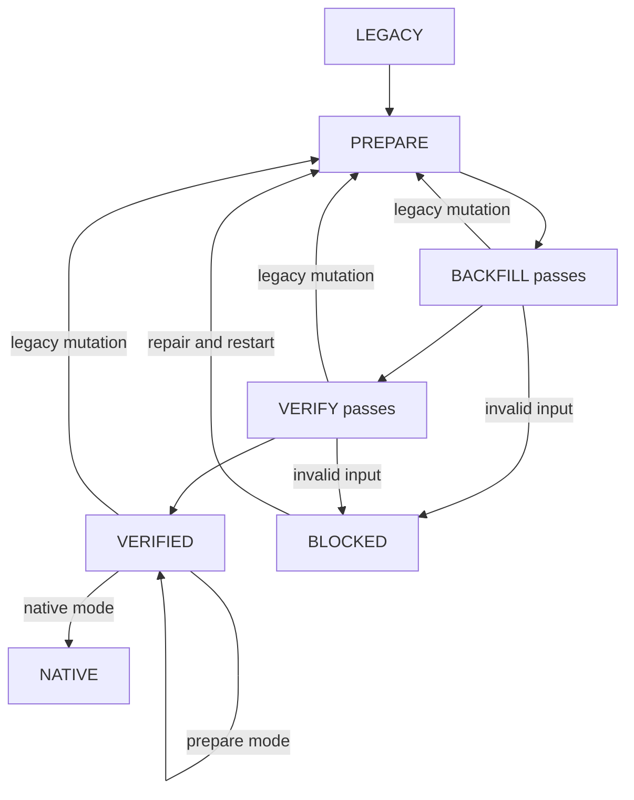
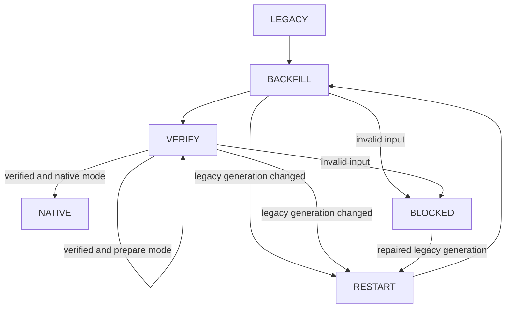
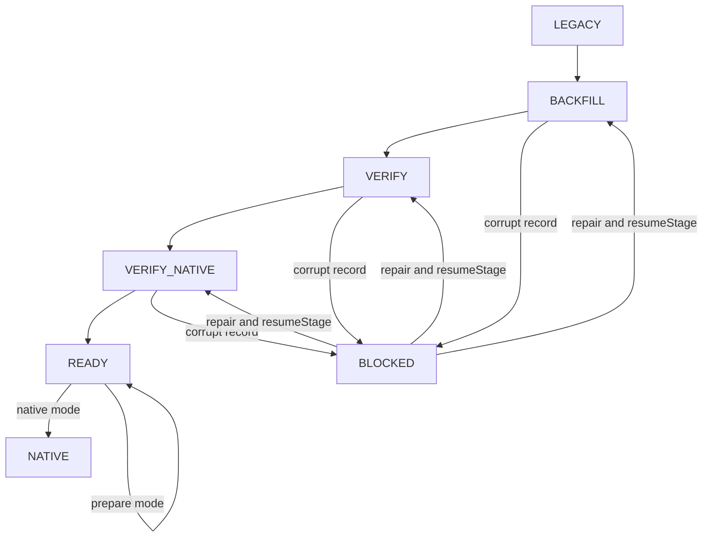

# Canonical storage migration and compatible rollback

Status: offline candidate implementation. Production migration, deployment, account quota measurements, real Firefox and provider acceptance are **DEFERRED_LIVE**. These procedures are for the Operator after explicit release authorization. They are not instructions for the implementation agent to contact production.

Authority: `CLIENT_SPEC.md`, `docs/PROTOCOL.md`, the optimization handoff, and the implementations in `activity-storage.ts`, `resource-storage.ts`, `operation-store.ts`, `registry.ts`, `workspace.ts`, and `index.ts`. The Registry Durable Object remains named `installation`; Workspace Durable Object names, bindings, credentials, Grants, Agent assignments and OAuth KV remain unchanged.

## Activation and authority

| Setting | Exact value | Behavior |
|---|---|---|
| `CANONICAL_STORAGE_MODE` | omitted or `legacy` | Default. Keep legacy authority where no native cutover exists. Stop incomplete canonical migration. Continue reading every already-native domain with the compatible reader. |
| `CANONICAL_STORAGE_MODE` | `prepare` | Create additive tables; perform bounded copy and verification; retain legacy authority. Activity stops at `VERIFIED`, Resource stops at `VERIFY` with `verified:true`, Workspace stops at `READY`. |
| `CANONICAL_STORAGE_MODE` | `native` | Perform preparation where necessary; permit each domain to switch authority only after its own verification completes. |
| `BINARY_PAYLOADS_ENABLED` | omitted or anything except `true` | Separate O06 control. Do not select BLOB storage for new image manifests/music intents. Existing BLOB markers still require their compatible reader. |
| `BINARY_PAYLOADS_ENABLED` | `true` | O06 new BLOB writes additionally require that Workspace operation storage has reached `NATIVE`. This setting does not initiate canonical Activity, Resource or Workspace migration. |

A flag change is not a data rollback. Native authority is durable and remains native when the flag becomes `prepare` or `legacy`. A request reads one authority for each domain. Domains and Durable Objects cut over independently; there is no cross-object atomic cutover. Old HTTP userscripts continue using the same operation, lease, authorization and result protocol.

### Binary compatibility fence

| Object/domain | Atomic cutover fence | Compatible candidate behavior | Older Worker behavior |
|---|---|---|---|
| Registry Activity or Resource | Persist `core.schemaVersion:2` in the same transaction as the first native marker; preserve all other core fields. | Accept core storage versions 1 and 2. Public readiness/protocol `schemaVersion` remains 1. | Baseline Worker 0.1.12 rejects the newer core storage version; it cannot serve stale legacy state. |
| Workspace operations | Persist `records['schema']=2` in the same transaction as `operation_migration_v2.stage='NATIVE'`. | Accept version 2 only with the matching native migration marker. | Baseline Workspace constructor rejects schema 2. |
| Retained legacy writes | SQLite triggers fence `activity`, `library`, and `operation/*` writes after their respective native cutovers. | Native writes target canonical tables. A Resource request loaded before cutover rechecks authority before committing and returns `RESOURCE_CONFLICT` if authority changed. | An already-running legacy writer aborts instead of updating a stale snapshot. |

No reverse migration is implemented. After any native cutover, rollback means deploying a verified compatible candidate binary that retains all native readers. Never deploy the baseline Worker, remove markers/triggers, reset a Durable Object, restore a stale snapshot, or restore data to an earlier external-effect state. Cloudflare code rollback does not roll back storage or provider effects.

## Authenticated operator interfaces

Every route below uses the existing management Bearer credential in the `Authorization` header. Never place a credential in a URL, Resource, exported settings, browser page code, or diagnostic capture.

| Method/path | Input | Deterministic outcome |
|---|---|---|
| `GET /api/v1/admin/state` | No body. | Current Registry management `revision` and library revision. Obtain a fresh management revision before a Registry mutation. |
| `GET /api/v1/admin/storage` | No body. | Configured mode plus Activity and Resource migration status and compatible rollback guidance. |
| `POST /api/v1/admin/storage/step` | JSON `{ "expectedRevision": <Registry revision> }`; fresh `Idempotency-Key`. | One bounded Activity step and one bounded Resource step. The existing management transaction persists the exact idempotent result and advances management revision. |
| `POST /api/v1/admin/storage/restart-activity` | JSON `{ "expectedRevision": <Registry revision> }`; fresh `Idempotency-Key`. | Restart a pre-native Activity migration at bounded `PREPARE`. Native Activity rejects this action. Repair malformed legacy input before restarting. |
| `GET /api/v1/admin/workspaces/:id` | No body. | Current authorized Workspace record and entity revision. |
| `GET /api/v1/admin/workspaces/:id/storage-migration` | No body. | Read that Workspace's migration stage, cursor, generation, resume stage and current authority. |
| `POST /api/v1/admin/workspaces/:id/storage-migration` | JSON `{ "action": "step", "expectedRevision": <Workspace entity revision> }`; fresh `Idempotency-Key`. | One bounded Workspace copy/verification/cutover step; schedules continuation while work remains. |
| Same Workspace POST | JSON `{ "action": "resume", "expectedRevision": <Workspace entity revision> }`; fresh `Idempotency-Key`. | Resume a repaired `BLOCKED` Workspace migration from its persisted resume stage. |
| `GET /api/v1/admin/workspaces/:id/recovery` | No body. | Existing recovery evidence, including `storageMigration`, unresolved operations and lease fences. |

The Worker authenticates Workspace migration access through the Registry and forwards only a fixed internal migration message. `/internal/migration` is a Durable Object implementation route, not a public privileged RPC surface. Workspace migration action receipts retain exact results for 24 hours, reject key reuse for another action, and cap retained receipts at 128; expiry cleanup removes at most 16 receipts per new action. Receipt persistence and the corresponding Workspace migration transaction commit together. A failed receipt write rolls back cutover.

Repeat an interrupted request with its original idempotency key and unchanged body to retrieve its recorded outcome. Use a new key for a new migration step. A status read does not authorize cutover, reset, source repair, or replay of an operation. Registry and Workspace expected revisions refer to their documented management entities; neither is an Activity revision, library revision, operation sequence, migration generation, nor Epoch.

## Activity

| Actual stage | Authority and action |
|---|---|
| `LEGACY` | Existing `activity` record and terminal-notice receipts remain authoritative. |
| `PREPARE` | Delete at most 32 obsolete shadow rows per step. Preserve legacy state. |
| `BACKFILL` | Stream the legacy Activity JSON array; append individual shadow entries and retain the last 1,000 ordinary visibility positions. Never materialize the full 10k-entry corpus. |
| `BACKFILL_NOTICES` | Copy uncertain terminal-notice overlays separately from ordinary visibility. |
| `VERIFY` | Traverse the legacy array again; compare retained base events and their stable sequence positions. |
| `VERIFY_NOTICES` | Compare each uncertain receipt overlay with its canonical shadow entry. |
| `VERIFY_ROWS` | Verify every shadow row, both side-presence markers, scope, phase and ordering metadata. |
| `VERIFIED` | Keep legacy authority in `prepare`. Recheck source generation before a native cutover. |
| `NATIVE` | `canonical_activity_v2` is authoritative. Append/update exact rows; do not rewrite the legacy Activity array. |
| `BLOCKED` | Preserve legacy authority and return fixed corruption classification. Stop automatic migration. Repair source, then use the authenticated restart action. |

An array step reads at most one 32,000-character source part and completes at most 32 events. A single retained event is limited to 512 KiB. A notice step processes at most 32 logical notices and less than 1 MiB decoded input, including the final accepted notice. Source-generation triggers cover legacy array and terminal-notice inserts, updates and deletes. A generation change before cutover restarts bounded preparation; continuing terminal traffic can postpone convergence.

Native ordering is unresolved overlay first, then descending effective timestamp, then the stable Workspace/Operation key. Ordinary history visibility remains capped at 1,000 positions. Uncertain receipts retain their separate unresolved lifetime; trimming ordinary visibility cannot erase a required hold or receipt. Resolution preserves the original outcome and updates the exact entry. Registry permits, receipts and generator-writer reservations remain distinct authorities with their existing retention and authorization rules.

Native continuation cursors start with `a2.` and bind the Activity revision, external management revision, status filter, Workspace filter and last ordering tuple. A stale/filter-mismatched cursor or an old offset cursor returns `STALE_REVISION`; restart the list. Cursor changes grant no access.

## Resource library

| Phase | Authority and action |
|---|---|
| `LEGACY` | The chunked `library` snapshot is authoritative. An absent, never-initialized library remains uninitialized until the existing default-library initialization runs; absence is not corruption. |
| `BACKFILL` | Stream snapshot framing and individual immutable revision/assignment objects into generation-scoped storage. Persist parser part/offset and lexical state. |
| `VERIFY`, `verified:false` | Traverse the unchanged legacy source again; compare source-part digests, immutable payload digests, metadata, revision ordering, graph, assignments, counts and exact serialized-history budget. |
| `VERIFY`, `verified:true` | Preparation complete. `prepare` remains here; `native` atomically installs native authority and the Registry binary fence. |
| `NATIVE` | Current pointers, immutable revisions, scoped assignments and content chunks are authoritative. Legacy snapshot is retained but never selected as fallback. |
| `RESTART` | A changed legacy generation invalidates the shadow. Delete at most 32 obsolete shadow rows per step, then begin a new generation. |
| `BLOCKED` | Persist fixed `RESOURCE_SNAPSHOT_INVALID`; stop migration alarms for this domain. A corrected legacy source changes its generation and permits bounded restart. There is no generic raw-SQL repair endpoint. |

Each normal Resource maintenance call reads at most four source parts of 32,000 UTF-16 characters and completes at most eight objects per source-part pass. Complete-object validation can materialize one existing accepted Resource value up to the existing 16 MiB library bound. This is an explicit per-item memory/CPU peak, not a claim that total validation allocation is limited to four source parts.

`resource_current_v2` contains current metadata and revision counts. `resource_revision_v2` contains immutable revision metadata, content references and integrity digest. `resource_content_v2` contains immutable JSON chunks for one revision or assignment. `resource_assignment_v2` indexes exact scope and preserves assignment order. Header counters enforce the original exact 16 MiB serialized library/history limit without reading unrelated bodies during publication. Content digests protect native payload integrity; existing public Resource hashes retain their accepted meaning.

Point lookup loads metadata for graph/visibility checks and the requested revision's content. Catalog/history metadata reads omit bodies. Explicit full export, full instructions and content search load the bodies required by those operations. Publish/restore/import use existing input, graph, archive and optimistic-concurrency rules; the canonical mutation and idempotency receipt commit together. Assignment replacement queues obsolete assignment content for cleanup; each cleanup invocation deletes at most 32 content rows. Immutable Resource revision history is not silently pruned.

A request refreshes its read revision before native history/assignment access. A legacy request that was awaiting work when cutover occurred cannot write a stale legacy snapshot afterward. Native content corruption, unknown format or missing rows fails closed; no retained snapshot fallback occurs. Export retains the existing ZIP package format and import limits; an exported entry uses uncompressed ZIP storage when ordinary compression would violate the existing import expansion-ratio guard. The 8 MiB compressed-archive input cap remains unchanged.

## Workspace operations

| Stage | Authority and action |
|---|---|
| `LEGACY` | `operation/*` records and their legacy projection remain authoritative. |
| `BACKFILL` | Copy typed operation metadata and separate immutable args/transient results; preserve missing versus explicit null using presence metadata and preserve remaining canonical fields in context JSON. |
| `VERIFY` | Walk legacy operation keys and compare complete canonical semantics to typed rows and payloads. |
| `VERIFY_NATIVE` | Walk native keys in reverse direction of the comparison to detect extra, missing or mismatched state. This is a second key traversal, not a reverse data migration. |
| `READY` | Keep legacy authority in `prepare`. Drain any newly dirty legacy keys before considering cutover. |
| `NATIVE` | Typed operation rows and separate args/results are sole authority. Install Workspace schema 2 and reject legacy `operation/*` writes. |
| `BLOCKED` | Preserve the last legacy authority and exact resume stage. Reject new admission with `GATEWAY_DEGRADED`; retain status/recovery access. Repair the exact malformed source before explicit `resume`. |

One Workspace step handles at most 16 logical records and 1 MiB of UTF-8 serialized JSON plus at most one accepted logical-record overshoot. Dirty legacy keys are reconciled in a separate batch before traversal/cutover. Inserts, updates and deletes from old writers enter a durable dirty set; the final cutover transaction cannot interleave with a legacy mutation. A transient SQL/quota failure rolls back the batch and leaves its cursor resumable. Corruption persists `BLOCKED` instead of silently defaulting a record.

`operation_native_v2` stores scope, sequence, phase, fences, deadlines, notification/retention state, receipt digest and context. `operation_args_v2` and `operation_result_v2` separate payloads. Minimal active, recovery, due and retention indexes support bounded access; transactional stats preserve queue/result/outbox/hold limits. Durable `RUNNING`, exact terminal receipt deduplication, late observations, result expiry, UNKNOWN/PARTIAL holds and generator reservations remain enforced. Migration never executes, replays or reconciles a provider effect by itself.

Successful authorized Workspace traffic can start a bounded step. An explicit migration `step`/`resume` schedules a persisted alarm; alarms continue while migration remains eligible, without requiring sustained polling. Status-only initialization does not promise that a dormant Workspace is scheduled; explicitly start each selected Workspace. Required active expiry, outbox delivery and uncertainty evidence remain independent of optional history cleanup.

## Temporary storage and migration cost

| Domain | Retained and added state during transition | Bounds and operator consequence |
|---|---|---|
| Activity | Legacy array/receipts, existing derived projection, new canonical entries and indexes, resumable parser state. | New ordinary visibility remains bounded at 1,000 positions; unresolved overlays have their separate lifetime. A partial event token can reach its 512 KiB accepted bound. Index pages and unresolved receipts prevent a universal two-times multiplier. |
| Resource | Legacy snapshot up to 16 MiB serialized, native immutable content, duplicated body-free metadata, source digests, assignment indexes, bounded stale-generation cleanup. | Content plus metadata temporarily coexist with the legacy snapshot. Exact current library/history budget remains 16 MiB; physical duplicate storage and SQLite/index overhead are additional. A complete Resource validation can require a 16 MiB value. |
| Workspace | Legacy operation records, old projection, typed native metadata, args/results and migration dirty set. | Temporary physical usage is approximately old representation plus new representation and indexes, not a guaranteed fixed ratio. Preserve all required active/unresolved state even when legacy input exceeds ordinary retention. Ordinary eligible history converges through existing bounded retention after migration. |
| O06 binary payloads | Existing JSON/Base64 payloads and new per-owner BLOB manifests can coexist. | No whole-payload copying is required for existing retained data. New BLOB payload chunks are at most the unchanged 192 KiB wire size. Count metadata and coexistence storage separately. |

Migration, verification, dirty tracking, deletes, indexes and alarm scheduling consume quota. Local SQL cursor measurements do not include authoritative Cloudflare account billing or unrelated applications. Budget migration separately from steady state and reserve completion/recovery headroom before activation. A fixed per-step record count does not establish a universal CPU, wall-time or physical-storage maximum for every accepted payload.

No automatic first-launch deletion removes the retained legacy array, library snapshot, operation records or old derived projection. Those copies become stale after native writes. Their deletion requires a separately reviewed compatible cleanup program, Operator approval and successful live acceptance; this candidate supplies no automatic destructive legacy cleanup action.

## Operator sequence after release authorization

1. Preserve the exact candidate, source archive, checksums and compatible rollback artifacts. Confirm the existing Worker name, Registry/Workspace bindings, OAuth KV, credentials and named Durable Objects. Record account quota/storage counters and pending UNKNOWN/PARTIAL effects. Do not re-pair, reset or rebind as part of storage migration.
2. Deploy the exact reviewed candidate with canonical mode `legacy` and new BLOB writes disabled. Verify existing HTTP client behavior and read-only readiness under the separate acceptance checklist. Keep production/provider mutations under their existing authorization gates.
3. Choose a quiet migration interval. Stop new expensive work as needed; allow already-dispatched work to complete or remain honestly unresolved. Native cutover must preserve such records; operator acknowledgement is not a substitute for migration verification.
4. Set `CANONICAL_STORAGE_MODE=prepare` on the existing deployment. Read Registry storage status. Start a Registry step and one Workspace step for every selected Workspace, with current expected revisions and new idempotency keys. Enumerate every Workspace page; do not infer that one object's readiness covers another.
5. Observe status at a bounded cadence. Alarms continue eligible work. Wait for Activity `VERIFIED`, Resource `VERIFY` with `verified:true`, and each Workspace `READY`. An uninitialized absent Resource library remains `LEGACY`; initialize the default library through its existing authorized workflow before preparing it if required. Record quota/storage deltas and cold/restart evidence. Do not activate native authority while corruption or missing verification remains unexplained.
6. On `BLOCKED`, preserve diagnostics and the last authority. Produce a reproducible fixture and a reviewed targeted repair for malformed legacy data; do not guess defaults or delete effects. After repair, restart Activity explicitly, resume Workspace explicitly, or let Resource's changed legacy generation restart bounded work. Transient provider quota/storage failures require restored capacity, not data reset.
7. Before cutover, setting mode back to `legacy` stops migration and retains the unchanged legacy authority. Once any native domain exists, use only a compatible candidate binary even if other domains remain legacy.
8. After explicit approval and measured headroom, set mode to `native`. Verify the native marker independently for Activity, Resource and every selected Workspace. The marker and binary fence commit atomically within each object. A failed commit must leave the prior authority intact.
9. Perform the separate read-only, scoped mutation, recovery, old HTTP client and restart acceptance checks. Validate exact source/resource revisions, unresolved receipts and expiry. Do not replay an operation to create migration evidence. Recheck actual account SQL, requests, alarms, storage and KV costs over a controlled UTC window.
10. Enable `BINARY_PAYLOADS_ENABLED=true` only under the separate O06 acceptance plan after Workspace native readiness. Each new image manifest/music intent fixes its `BLOB_V1` format; existing unmarked payloads retain legacy decoding. Flag-off affects future writes, while reads/ACK/expiry honor existing BLOB markers. Missing/corrupt native payload never falls back or regenerates an uncertain paid intent.
11. If rollback is needed after cutover, pause new admission where necessary and deploy the verified compatible reader. Preserve current storage and external-effect evidence. Disable optional push or future BLOB writes independently; neither setting restores legacy authority. Keep retained snapshots until a separately authorized cleanup program is reviewed.

Offline evidence is recorded in the final optimization report and the Activity, Resource and operation-store tests. Physical Cloudflare migration behavior, actual hibernation/billing, real Firefox/CSP and provider acceptance remain **DEFERRED_LIVE** until the Operator records those results.
