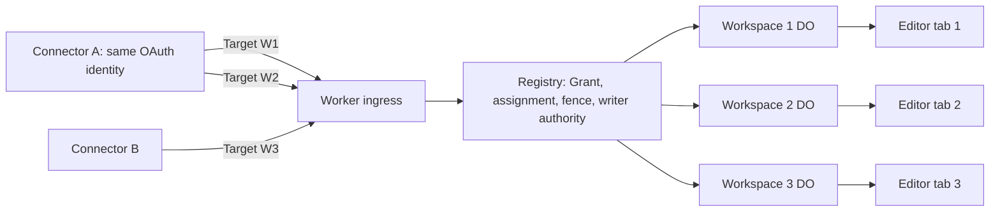

# Perch MCP v0.3 — architecture decision proposal

**Date:** 2026-11-27  
**Status:** design synthesis of the two operator-accepted proposals; additional engineering decisions below are proposed implementation defaults.  
**Baseline:** `Neb963/perch-mcp-userscript`, `main` merge commit `9524583b04e480875011f3675a581357afe315c3`, tree-equivalent to tested PR #23 head `3fd1e48630737a1defd96484a3af3d3d881c84a1`.  
**Implementation authority:** companion `PERCH-MCP-V0.3-IMPLEMENTATION-SPEC.md`; agent execution instructions in `PERCH-MCP-V0.3-CODING-AGENT-PROMPT.md`. No code, production settings or Workspace assignments were modified while preparing this proposal.

## 1. Executive decision

Perch MCP is a remote Perchance development environment, not a replacement for the native AI Helper. Retain 19 public tools, operator-managed generator lifecycle, agent-local knowledge, explicit per-request Workspace targeting, one-to-many Connector assignments, local execution and verified Save. Build on merged v0.2.0. Preserve the offline-qualified gateway infrastructure but remove obsolete Resource/media execution paths. Do not deploy v0.3 merely because it compiles. No new service, database binding, desktop daemon, browser extension, or paid provider is required by the design. Actual-pixel capture may require a browser-supported operator action; if no safe userscript-only path exists, report the blocker instead of inventing a substitute.

| Decision | Reversibility | Cost/compromise |
|---|---|---|
| Explicit Target per call, no selected Workspace | High before contract cutover; low afterward | Additional short argument, eliminates shared routing race |
| One Connector owns many Workspaces; each Workspace has at most one Connector | High | No cross-Connector sharing; simple indexed ACL |
| Connector-level Grant with explicit operator assignment | Low: security contract migration | One reauthorization; future rebinds do not require reauth |
| Agent-side knowledge package | High | Operator must install compatible knowledge in each client; no runtime retrieval |
| Five filesystem primitives + local computation | High | Full-file writes can cost more tokens; local guarded transformations avoid that |
| Single-Workspace bounded batch | Medium | Partial outcomes are visible; not distributed atomicity |
| Generation-scoped local stores | Low after publication | Migration/quarantine of old journals; no silent reuse across targets |
| Preserve native canonical storage readers | Low after native cutover | No return to old binaries without compatibility |
| Advisory hibernatable push + HTTP authority | High (flag) | Browser sleep requires fallback; no real hibernation guarantee from mocks |
| Screenshot transport over existing scoped binary path first | High | Temporary storage costs; direct transit is optional only after equivalent proof |

## 2. Source evidence and implications

The accepted input documents are `PERCH-MCP-MINIMAL-DEVELOPMENT-OPTIMIZATION.md` and `PERCH-MCP-MULTI-WORKSPACE-ASSIGNMENT-PROPOSAL.md`. Both were reopened from the supplied files. PR #23 was merged before this task; its qualification is evidence for v0.2, not for v0.3. Source inspection is pinned to the merge commit, not a moving branch. The following is static evidence, not a new runtime benchmark.

| Evidence | Finding | v0.3 implication |
|---|---|---|
| [Registry](https://github.com/Neb963/perch-mcp-userscript/blob/9524583b04e480875011f3675a581357afe315c3/apps/gateway/src/registry.ts), interfaces around L35–115, authorize around L1012 | Agent has one workspaceId; Grant and AuthProps contain workspaceId and bindingRevision; pause is checked in authorization | Separate identity authentication from target authorization. Discovery/recovery need different predicates than dispatch. |
| [Gateway index](https://github.com/Neb963/perch-mcp-userscript/blob/9524583b04e480875011f3675a581357afe315c3/apps/gateway/src/index.ts), OAuth/MCP around L198–395 | Access token TTL 900 s; refresh TTL 30 days; request-level immutable authorization snapshot; catalog includes unavailable tools; explicit status retrieval | Keep SDK, audience, request-local snapshots; resolve target at admission; avoid reintroducing duplicate RPCs. Token refresh must not depend on an arbitrarily selected Workspace. |
| [Native adapter](https://github.com/Neb963/perch-mcp-userscript/blob/9524583b04e480875011f3675a581357afe315c3/apps/userscript/src/adapter.ts), L203–252 | Full snapshot reads every src twice, compares listings/panels/identity; applyFiles scans before and after each write | Read/list targeted; use native generation only after proof; preserve whole-source verification at Save and necessary mutation boundaries. |
| [VFS](https://github.com/Neb963/perch-mcp-userscript/blob/9524583b04e480875011f3675a581357afe315c3/apps/userscript/src/vfs.ts), L11–75, checkpoint/trim | `perch:workspace:${workspaceId}` local prefix; whole scratch/import manifest contains base64; automatic full checkpoint | Separate identity generations, content-addressed local blobs, bounded manifest pointers, preserve unresolved journals and pins. |
| [Controller](https://github.com/Neb963/perch-mcp-userscript/blob/9524583b04e480875011f3675a581357afe315c3/apps/userscript/src/controller.ts), L150–205, L1124+ | VFS created by Workspace ID; child permit requests per broker action; lease/identity checks | Fix every creation/recovery path; read-view permit and staged commit, not arbitrary nested privileged calls. |
| [Runtime tools](https://github.com/Neb963/perch-mcp-userscript/blob/9524583b04e480875011f3675a581357afe315c3/apps/userscript/src/runtime-tools.ts), L343–439 | QuickJS module reads, broker reads/list/revision, staged writes; separate authorization for additions/deletes | Retain engine/isolation, remove per-read network calls under bounded scope; validate exact staged commit. |
| [Shared contracts](https://github.com/Neb963/perch-mcp-userscript/blob/9524583b04e480875011f3675a581357afe315c3/packages/contracts/src/tools.ts) | Original put_files supports 64 items and mandatory base; binary max 256 KiB per item; 16 pinned modules; save intendedRevision | Reuse validation and implementation; distinguish aggregate wire cap from individual file cap. |
| [Optimization report](https://github.com/Neb963/perch-mcp-userscript/blob/9524583b04e480875011f3675a581357afe315c3/docs/verification/gateway-optimization-report.md) | Native full ingress 177–182 reads/51–52 writes; baseline 218–249/70–84; exact status 19→2 reads; ten writes 1880/540→188/54; legacy candidate more expensive | Preserve measurements, use native and legacy comparisons, prioritize fewer durable lifecycles and read amplification. |
| [Storage migration](https://github.com/Neb963/perch-mcp-userscript/blob/9524583b04e480875011f3675a581357afe315c3/docs/optimization/STORAGE-MIGRATION.md) | Native authority is per domain, markers are irreversible for old readers; pre-index nonempty Workspaces may be quiesced | Do not discard v0.2 native readers or activate Resource migration just to retire it. Test all authority modes. |
| [Connector docs](https://github.com/Neb963/perch-mcp-userscript/blob/9524583b04e480875011f3675a581357afe315c3/docs/CONNECTORS.md) | Reused connector shares Grant, not conversation identity; rebind revokes old Grant | New consent semantics required; same-Connector chat isolation is advisory only. |
| [Production workflow](https://github.com/Neb963/perch-mcp-userscript/blob/9524583b04e480875011f3675a581357afe315c3/.github/workflows/verify-deployed-gateway.yml) | Push to main probes production; Cloudflare Git integration has already attempted preview build | Work on non-production branch; no main merge, production workflow dispatch or preview. Operator disabled previews, do not assume production deploy disabled. |

## 3. External feasibility research (public documentation, checked 2026-11-27)

| Primary reference | Consequence |
|---|---|
| [MCP 2026-07-28 revision announcement](https://blog.modelcontextprotocol.io/posts/2026-07-28/) | New per-request protocol retired MCP session header; legacy sessions are not conversation identity. Explicit Target works across both profiles. |
| [MCP TypeScript SDK authorization](https://ts.sdk.modelcontextprotocol.io/v2/serving/authorization), [RFC 8707](https://www.rfc-editor.org/rfc/rfc8707), [OAuth security BCP RFC 9700](https://www.rfc-editor.org/rfc/rfc9700) | Verify exact audience, issuer, client and Grant. Preserve official SDK and PKCE; do not accept tokens for another Connector even when client IDs match. |
| [Violentmonkey privileged APIs](https://violentmonkey.github.io/api/gm/) | Documented GM surface has storage and requests, not a general tab-pixel capture API. Do not assume privileged WebExtension APIs are callable by a userscript. |
| [MDN getDisplayMedia](https://developer.mozilla.org/en-US/docs/Web/API/MediaDevices/getDisplayMedia) | Requires transient activation, user surface selection and permission; permission is not reusable as permanent authorization. Capture can fail on focus/permissions/OS state. |
| [MDN tabs.captureTab](https://developer.mozilla.org/en-US/docs/Mozilla/Add-ons/WebExtensions/API/tabs/captureTab), [captureVisibleTab](https://developer.mozilla.org/en-US/docs/Mozilla/Add-ons/WebExtensions/API/tabs/captureVisibleTab) | Extension-only APIs; Firefox captureTab requires all_urls, visible capture requires appropriate permission and active tab. Not a Violentmonkey solution without additional authorized component. |
| [Cloudflare DO pricing](https://developers.cloudflare.com/durable-objects/platform/pricing/) | SQL row billing, indexes, alarm writes and request/duration dimensions are distinct; local counters do not prove exact provider bill. |
| [Cloudflare DO WebSockets](https://developers.cloudflare.com/durable-objects/best-practices/websockets/), [DO lifecycle](https://developers.cloudflare.com/durable-objects/concepts/durable-object-lifecycle/) | Hibernation uses server-side API; durable authority survives eviction; attachments only metadata. No reliance on in-memory pending writes or timers for safety. |
| [KV pricing](https://developers.cloudflare.com/kv/platform/pricing/), [KV limits](https://developers.cloudflare.com/kv/platform/limits/) | Separate daily write limit and same-key rate limit; account usage shared. No KV writes for each operation or heartbeat. |
| [Workers Builds branch control](https://developers.cloudflare.com/workers/ci-cd/builds/build-branches/) | Preview off does not imply production push is safe. Preserve nondeploying branch. |

This research does not establish that the current Firefox/Violentmonkey environment can autonomously capture exact preview pixels, that native Perchance exposes a reliable per-file mutation generation, or that ChatGPT accepts every new tool/structured image shape. These are explicit acceptance gates. Do not confuse API documentation with live qualification. No private provider API, actual generator, OAuth endpoint or production Worker was queried.

## 4. Core architecture and invariants

Canonical Connector is the authenticated external principal (legacy persisted `agentId` may be retained as a documented compatibility field). Workspace is a reusable execution slot, not a generator. Binding identifies exact native Generator ID, Draft ID and browser installation; Slug is display metadata. Target encodes Workspace ID + Binding generation + assignment generation; it is not a secret or bearer credential. Epoch fences active browser leases, not logical assignment; ordinary reconnect need not invalidate a Target. A Connector can have zero/many Workspaces. A Workspace can have zero/one Connector; do not add groups or cross-Connector grants. No implicit target even for one Workspace. No shared selected slot. Every operation and result belongs to a specific authenticated scope. Native Generator ID writer reservation remains installation-wide even across draft IDs; same generator in two browsers is not thereby safe to mutate. Operator/native manual edits are not controlled by the gateway.

### Security model and linearization

The Registry remains strongly consistent authority; Workspace DO owns execution state. Authentication checks token audience + active Connector Grant; authorization resolves target server-side against indexed assignment and current binding, policy, lease/writer fences. A forged Target cannot confer access. Foreign/missing Targets receive equivalent denial without disclosing labels or ownership. An authorized old Target returns stale only if current ownership is verified. Use exact Grant ID for operation retrieval/cancel (refresh retains Grant; replacement Grant cannot inherit result access automatically). Operator recovery can inspect older evidence independently. Discovery is allowed for paused/offline owned Workspaces and zero assignments, but no browser execution follows. Permission narrowing/revocation denies new permits; already consumed bounded permits are in flight and cannot be magically undone. Check current policy again before delivering results. Never cache an authorization across requests.

A prevalidated local batch can amortize dispatch overhead because the entire bounded plan is one admitted operation. Pure read view, local staged computation and exact source transaction are not separate remote authorizations per file. Fresh permits at write publication and every externally effectful preview/POST/Save boundary preserve revocation semantics. This is stricter than a single long unrestricted permit; it costs a few boundary RPCs, still independent of individual read count. A runtime guest cannot choose its own permissions, targets, credentials or arbitrary host calls.

## 5. Data consistency, storage and capture tradeoffs

- Separate observed per-file digest, complete verified native source revision, private local revision and preview revision. The previous complete VFS hash includes scratch/imports; it is not the native Save identity. A cached full revision can be displayed with `verified:false` but cannot be asserted as current. Use a fresh full snapshot where proof is absent. Listing with unknown sizes/digests must say unknown, not read every file to fill metadata.
- Without native transactional CAS/change generation, concurrent external edits can race between read and native setter. Use readiness, immediate re-read of affected paths, full verification where needed, durable intent, conflict/partial hold, no blind rollback. Do not promise absolute prevention of every manual TOCTOU race. Refuse known unsafe collaboration state. Fast generation-based path is conditional on demonstrable complete coverage, including viewer buffers, collaboration, native Helper and same-size edits; conservative fallback can cost O(N) scans per write. Targeted reads still reduce routine reads substantially.
- Content-addressed local blobs with immutable manifests are an implementation technique, not a new cloud service. Deduplicate within binding namespace, not across connectors. Read back durable bytes before pointer publication. A GM store is shared across tabs for a script; neither a tab-local promise queue nor wall-clock timestamp is a cross-tab lock. Isolate stale leases via generation/epoch and append-only intents; if atomic local pointer update across writers cannot be established, use distinct epoch writers, verified adoption and refuse overlapping mutations. GC uses reachable roots including unresolved operations and pins, bounded sweep, no eviction of ambiguous evidence. Budget physical bytes as well as decoded size; base64 expansion and copy peaks matter.
- Real screenshot: first evaluate supported native preview capture (not private Helper APIs); then browser capture only with genuine operator activation, positively verified selected tab/surface, correct crop and no unrelated content. Capture only trusted current preview bounds; if unverifiable, deny. A persistent screen-share stream is a privacy risk; default one-shot and stop tracks. A DOM renderer is not equivalent. Keep `capture_page_image` advertised with truthful availability; a consent-required or unsupported outcome is not a successful capture. Optional companion extension requires separate approval. Existing scoped image transport is preferable to a fragile direct-stream redesign as first implementation. Test no duplicate base64 in structured text, expiry and image delivery on both direct and status result paths.

## 6. Quota economics and empirical targets

PR #23 provides a measured ordinary native lifecycle of up to 182 reads / 52 writes, before later cleanup; legacy may regress (empty history 232/80 versus original 218/72). Exact status 2 SQL reads is Workspace-local, not total OAuth+Registry+Workspace cost. No new hard target should pretend these are a theoretical floor. Retain SQL instrumentation, native/legacy comparators, bounded maintenance, conservative recovery reserve, advisory push, binary payloads, and tested artifact packaging. Resource and music optimizations are obsolete; retain only migration/export/reconciliation needed for existing data.

| Scenario | Illustrative calculation, not a bill |
|---|---|
| 10 Connectors × 2 Workspaces, 100 individual development actions each per day | 2,000 lifecycles × 52 writes = 104,000 synchronous SQL writes, excluding idle/cleanup/index/alarm/other costs |
| Same actions in groups of 5 | 400 lifecycles × 52 = 20,800 writes if equivalent per-batch cost; actual batch payload/permit cost higher, must measure |
| 10 continuously refreshing Connectors at 15 min TTL | 10 × 96 × 2 = 1,920 KV puts/day, excluding issuance |
| At 60 min hypothetical TTL | 480 KV puts/day for same 10 clients; at 20 clients 960/day, before issuance |
| 20 Workspaces × 8 h, idle | v0.2 modeled HTTP 50,040 Worker requests; push 10,540; not physical measurement |

The arithmetic assumes one refresh per TTL and full utilization; clients can refresh early or concurrently, and actual counts differ. Registry revocation still protects new dispatch even with longer token TTL, but stolen-token window and SDK/refresh compatibility change. Measure 15/30/60/120 min candidates, prefer 60 min default only after security/interoperability assessment and explicit recorded decision; otherwise keep 900 s and document capacity constraint. No custom OAuth store rewrite or unsafe token reuse. Account-wide quota cannot be inferred from local counters; allocation policy is conservative, separate completion reserve from new admissions and never prevent terminal delivery just because local estimates are exhausted. Existing default opt-in budget (~30 operations/Workspace/day) is unsuitable without recalibration. No global lock on every broker read. Do not create 20 persistent polling loops for 20 idle chats; only attached Workspaces require leases. Keep UI polling tied to visible management panels and use bounded backoff.

## 7. Unknown-unknowns register and investigation exits

| ID | Failure hypothesis | Evidence/experiment and exit criterion |
|---|---|---|
| R01 | OAuth client caches old catalog or reuses same provider clientId | Loopback same-client distinct audiences, old/new Grant and old schema tests; owner real-client gate. No targetless fallback on v2. |
| R02 | Old token/approval follows rebind or transfer | Race admission/dispatch/approval/refresh vs assignment CAS; old Target fails; pending legacy approval cannot widen scope. |
| R03 | Workspace status exposes foreign labels, timings, results or cursor | Negative scoped discovery/status/cancel/transfer tests; filter before projection, no fanout. |
| R04 | Rebind old tab's delayed write lands after new lease | Inject pauses before dispatch, after permit, after native call; block transition on unresolved effect, old envelope rejected. |
| R05 | Same slug different generator, draft switch, reload, duplicate tab, navigation | Identity proof and lease epoch tests; no slug-only routing or auto-rebind. |
| R06 | GM local files leak into another Binding/Connector | Fixture same Workspace ID across two bindings/owners, migration with unknown provenance; quarantine not auto-copy. |
| R07 | Same-size native edit leaves metadata unchanged | Fake native adapter races and native observation capability probe; no cached verified revision unless reliable. |
| R08 | Rename swap, directory prefix collision, empty/binary files, Unicode/case aliases | Strict paths, reject cycles initially, readback exact bytes; preserve original on preflight failure. |
| R09 | Batch timeout after effects, oversized result after success | Durable step ledger, bounded projection before execution; retain effect state and result-expired/too-large metadata. |
| R10 | QuickJS escape or child calls bypass permission intersection | Negative tests for ambient network/GM/DOM/recursive tools/foreign target, CPU/memory limits, commit permit. |
| R11 | Preview iframe navigation, spoofed frame messages, delayed diagnostics | Correlate preview epoch/origin/window/request and native draft; untrusted generator results never authorize effects. |
| R12 | Screenshot wrong tab, crop or stale viewport | Positive surface identity and revision proof, pixel fixture and consent/stop tests; unsupported if proof absent. |
| R13 | Browser suspension, Worker rollout/hibernation, socket replay | Old ticket/lease rejection, fallback, reconnect, version skew; no silent effect replay. |
| R14 | Storage quota/GC/partial write loses checkpoint or journal | Inject crashes at every blob/pointer/terminal fence, verify reachability and refusal before native effects. |
| R15 | Retired Resource or paid-media operation still unsettled | Export/quarantine read-only, preserve paid intent/holds; no migration or regeneration just to remove UI. |
| R16 | Budget exhaustion prevents terminal receipts | Reserve completion/recovery, preserve local evidence, isolate failed Workspace; actual provider failure remains possible. |
| R17 | Real ChatGPT client cannot send Target, operation IDs or large payloads | Test protocol schemas offline then operator acceptance; no reliance on hidden chat IDs or custom client upload feature. |
| R18 | Upgrade after native migration breaks older rollback binary | All legacy/prepare/native combinations and old binary fences; forward repair, compatible rollback only. |
| R19 | Data exfiltration via fetch redirect/private DNS or preview capture | Retain public network and frame restrictions; fail closed where destination safety not provable; no arbitrary proxy. |
| R20 | Untrusted source or fetched skills instruct agent to change target | Knowledge package trust guidance, strict server ACL, explicit user-selected target; same-Connector chats not independent principals. |
| R21 | Many idle manager tabs poll admin/OAuth endpoints | Visibility-scoped, bounded single-flight refresh, no per-conversation persisted session, instrument idle/active workloads. |
| R22 | Build config deploys from new branch | Operator confirmed preview builds off; inspect workflows, branch only, no remote Wrangler/production probes or merge. |
| R23 | Old v0.2 clients call removed tools during rollout | Explicit protocol/contract version, fixed legacy route/grant only during transition, stable endpoint after fresh consent, no silent widening. |
| R24 | Generator server state changes during preview test | Preview eval is open-world capability, not read-only; use authorized disposable fixtures, no unapproved production changes. |
| R25 | Revocation races final result delivery | Recheck current scope before result release, no cache across requests, accept already delivered bytes cannot be recalled. |

## 8. Implementation sequencing and stop conditions

Specification phases V00–V10 separate authority, connector/assignment, local storage, filesystem, composition, preview, knowledge retirement, manager, economics and qualification. Preserve independent verified commits and use existing tests as a regression oracle, not a requirement to preserve removed tool names. Defer live gates explicitly. A candidate can be delivered offline with a documented unavailable screenshot path, but cannot be called fully accepted or operationally complete if the required pixel-capture gate remains unresolved. No need to ask operator for missing historical skills: existing repository contains the knowledge source; supplied input files and companion spec are sufficient. No production access or live testing is authorized by this package.
